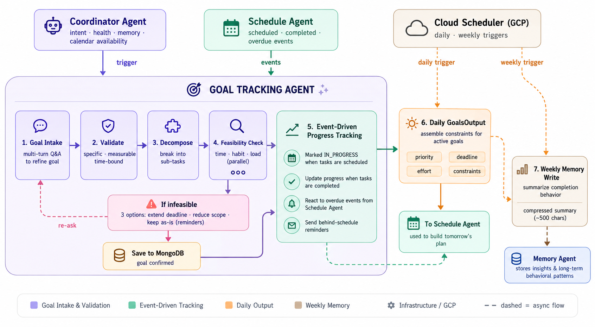
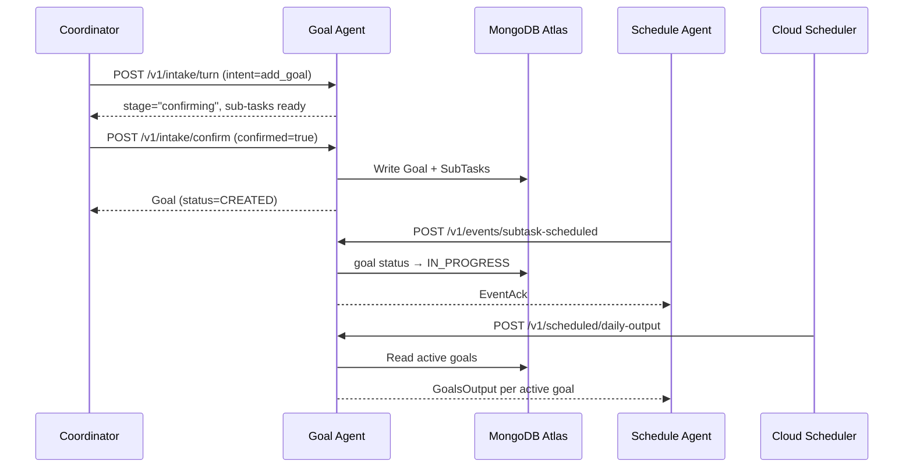

# Goal Tracking Agent — Integration Guide

## Table of Contents

- [1. How This Agent Works](#1-how-this-agent-works)
- [2. Running Locally](#2-running-locally)
- [3. Integration Guide by Agent](#3-integration-guide-by-agent)
  - [3.1 Coordinator Agent](#31-coordinator-agent)
  - [3.2 Schedule Agent — Inbound Events](#32-schedule-agent--inbound-events)
  - [3.3 Schedule Agent — Outbound from Goal Agent](#33-schedule-agent--outbound-from-goal-agent)
  - [3.4 Cloud Scheduler](#34-cloud-scheduler)
- [4. Codebase Structure (Reference Only)](#4-codebase-structure-reference-only)

---

## 1. How This Agent Works




The Goal Tracking Agent manages the full lifecycle of user goals in DayPilot — including goal validation, task decomposition, feasibility analysis, and long-term progress tracking.

The agent is always triggered by the Coordinator Agent, which already prepares the user intent, calendar availability, health data, and memory context before calling the service. The Goal Agent never reads raw user input directly.

During goal intake, the agent guides the user until the goal becomes specific, measurable, and time-bound. Once validated, it breaks the goal into smaller actionable tasks and performs a feasibility check using:
- available calendar time
- historical completion patterns from the Memory Agent
- the user’s current workload

If the goal is unrealistic, the agent offers three options:
1. extend the deadline
2. reduce the scope
3. keep the goal as-is with reminder support

After confirmation, the goal is stored in MongoDB and returned to the Coordinator.

From that point onward, the agent becomes fully event-driven. It automatically updates goal states when tasks are scheduled or completed, recalculates progress, and handles overdue reminders triggered by the Schedule Agent.

Every day, Cloud Scheduler activates the Goal Agent to generate a GoalsOutput object for each active goal. This includes priorities, deadlines, effort estimates, and planning constraints that the Schedule Agent uses to build the next-day schedule.

The Goal Agent does not assign calendar time slots directly — all scheduling decisions are handled by the Schedule Agent.

In addition, a weekly Cloud Scheduler job summarizes user completion behavior and sends the behavioral insights to the Memory Agent, helping DayPilot learn user habits, workload patterns, and long-term consistency over time.



---

## 2. Running Locally

### Environment Variables

| Variable | Required | Description |
|---|---|---|
| `MONGO_URI` | Required | MongoDB Atlas connection string |
| `GEMINI_API_KEY` | Required | Gemini API key for all LLM agents |
| `GCP_PROJECT` | Required | Google Cloud project ID |
| `MEMORY_AGENT_URL` | Required | Memory Agent base URL; default `http://localhost:8001` |
| `CALENDAR_SERVICE_ACCOUNT_JSON` | Required | File path or raw JSON of the Google Calendar service account key |
| `MONGO_DB_NAME` | Optional | Database name; default `goal_tracking` |
| `OVERLOAD_THRESHOLD_MINUTES` | Optional | Total active effort (minutes) that triggers an overload warning; default `600` |
| `API_BEARER_TOKEN` | Optional | Shared secret sent by the Coordinator as `Authorization: Bearer <token>`; leave empty to disable auth in dev |

### Install and Start

```bash
cp .env.example .env   # fill in credentials
pip install -e ".[dev]"
uvicorn app.main:app --reload --port 8000
```

### Verify

```bash
curl http://localhost:8000/healthz
# {"ok":true}
```

---

## 3. Integration Guide by Agent

All `/v1` endpoints require `Authorization: Bearer <API_BEARER_TOKEN>`. Set `API_BEARER_TOKEN=""` in `.env` to disable auth locally.

---

### 3.1 Coordinator Agent

#### `POST /v1/intake/turn`

**When to call:** The user wants to create a goal (`add_goal`) or continue an in-progress intake session (`add_goal_continue`). Call once per user message until `stage` reaches `"confirming"`.

**Request**

| Field | Type | Req | Description |
|---|---|---|---|
| `user_id` | string | Yes | Stable user identifier |
| `intent` | string | Yes | `"add_goal"` (new) or `"add_goal_continue"` (resume) |
| `raw_user_message` | string | Yes | The user's message, forwarded verbatim |
| `health` | object | Yes | `{energy_score: float, focus_windows: [{start, end}], cognitive_load: float}` — from Health Agent |
| `memory_context` | string | Yes | Compressed behavioral history from Memory Agent; `""` for new users |
| `calendar_free_slots` | array | Yes | `[{start, end, duration_minutes}]` — pre-fetched by Coordinator |
| `session_id` | string | No | Omit on the first turn; pass on every subsequent turn |

```json
{
  "user_id": "usr_4f2a1b8c",
  "intent": "add_goal",
  "raw_user_message": "I want to solve 10 Leetcode medium problems by June 6.",
  "health": {
    "energy_score": 0.75,
    "focus_windows": [{"start": "2026-05-29T09:00:00Z", "end": "2026-05-29T12:00:00Z"}],
    "cognitive_load": 0.3
  },
  "memory_context": "User completes weekly coding goals 25% slower than estimated.",
  "calendar_free_slots": [
    {"start": "2026-05-29T09:00:00Z", "end": "2026-05-29T12:00:00Z", "duration_minutes": 180}
  ],
  "session_id": null
}
```

**Response**

| Field | Type | Description |
|---|---|---|
| `session_id` | string | Pass this back on every subsequent turn |
| `stage` | string | Current stage: `"initial"` → `"validating"` → `"decomposing"` → `"feasibility"` → `"confirming"` |
| `assistant_message` | string | Show this to the user |
| `goal_id` | string\|null | Populated only when `stage == "confirming"` |
| `validation_failures` | array | Non-empty when the agent is waiting for more information from the user |

```json
{
  "session_id": "f7a3b92d-1c4e-5f68-a9b2-3c4d5e6f7a8b",
  "stage": "confirming",
  "assistant_message": "I've broken your goal into 10 sub-tasks, one per problem. Feasibility score: 0.82. Ready to confirm?",
  "goal_id": "goal_8c3f1d2e",
  "validation_failures": []
}
```

---

#### `POST /v1/intake/confirm`

**When to call:** After the user explicitly confirms or rejects the proposed sub-task list.

**Request**

| Field | Type | Req | Description |
|---|---|---|---|
| `session_id` | string | Yes | From the last `/intake/turn` response |
| `user_id` | string | Yes | |
| `confirmed` | boolean | Yes | `false` resets to `"decomposing"` so the user can revise sub-tasks |

```json
{
  "session_id": "f7a3b92d-1c4e-5f68-a9b2-3c4d5e6f7a8b",
  "user_id": "usr_4f2a1b8c",
  "confirmed": true
}
```

**Response** — the created `Goal` document

```json
{
  "goal_id": "goal_8c3f1d2e",
  "user_id": "usr_4f2a1b8c",
  "title": "Solve 10 Leetcode medium problems by June 6",
  "goal_type": "weekly",
  "status": "CREATED",
  "created_at": "2026-05-29T09:14:22Z",
  "deadline": "2026-06-06",
  "progress_percent": 0.0,
  "feasibility_score": 0.82,
  "feasibility_note": "",
  "total_effort_minutes": 450,
  "suggested_blocks_count": 5,
  "suggested_split_ratio": [0.2, 0.2, 0.2, 0.2, 0.2],
  "sub_tasks": [
    {
      "sub_task_id": "st_a1b2c3d4",
      "goal_id": "goal_8c3f1d2e",
      "title": "Solve Leetcode medium problem 1",
      "estimated_minutes": 45,
      "priority": "medium",
      "deadline": "2026-06-06",
      "preferred_time_of_day": "morning",
      "can_split": false,
      "is_completed": false,
      "completed_at": null,
      "planned_date": null
    }
  ]
}
```

**Integration rules**

- Pre-assemble `health`, `memory_context`, and `calendar_free_slots` before every `/intake/turn` call. This agent never fetches them itself.
- Pass `session_id` back on every turn after the first. Omitting it starts a new session.
- A 410 response means the session expired (TTL is 24 hours). Start a fresh session — do not retry with the same `session_id`.

---

### 3.2 Schedule Agent — Inbound Events

All three event endpoints share the same response schema (`EventAck`):

| Field | Type | Description |
|---|---|---|
| `status` | string | `"acknowledged"` \| `"already_processed"` \| `"partial"` |
| `processed_count` | integer | Number of sub-tasks successfully handled |
| `warnings` | array | Unknown `sub_task_id` entries, or `"reminder:<message>"` strings to surface to the user |

---

#### `POST /v1/events/subtask-scheduled`

**When to call:** A sub-task has been added to the user's daily plan. This triggers the goal's transition from `CREATED` to `IN_PROGRESS`.

```json
{
  "event_id": "9b2c3d4e-5f6a-7b8c-9d0e-1f2a3b4c5d6e",
  "sub_task_id": "st_a1b2c3d4",
  "goal_id": "goal_8c3f1d2e",
  "start_time": "2026-05-29T09:00:00Z"
}
```

```json
{"status": "acknowledged", "processed_count": 1, "warnings": []}
```

---

#### `POST /v1/events/overdue`

**When to call:** A sub-task's scheduled start time has passed and the user did not complete it.

```json
{
  "event_id": "3a7f2b9c-1d4e-5f68-a9b2-3c4d5e6f7a8b",
  "overdue_tasks": [
    {
      "sub_task_id": "st_a1b2c3d4",
      "goal_id": "goal_8c3f1d2e",
      "start_time": "2026-05-29T09:00:00Z"
    }
  ]
}
```

```json
{
  "status": "partial",
  "processed_count": 1,
  "warnings": [
    "reminder:You're behind on 'Solve 10 Leetcode medium problems by June 6' — 9 of 10 sub-tasks remain and your deadline is 2026-06-06. Would you like to replan or adjust the goal?"
  ]
}
```

---

#### `POST /v1/events/subtask-completed`

**When to call:** The user has checked off a sub-task. If this brings progress to 100%, the goal is automatically transitioned to `COMPLETED`.

```json
{
  "event_id": "c4d5e6f7-a8b9-0c1d-2e3f-4a5b6c7d8e9f",
  "sub_task_id": "st_a1b2c3d4",
  "goal_id": "goal_8c3f1d2e",
  "completed_at": "2026-05-29T10:45:00Z"
}
```

```json
{"status": "acknowledged", "processed_count": 1, "warnings": []}
```

---

**Integration rules (all three endpoints)**

- Every request must include a caller-generated UUID as `event_id`. Retries must reuse the same `event_id` — the service returns `"already_processed"` without re-executing.
- When scheduling a sub-task, embed this service's `sub_task_id` and `goal_id` in the Schedule Agent's own `task_id` or `notes` field. Without this, overdue notifications cannot be matched to the correct goal and the event will return `"partial"` with an `unknown_sub_task_id` warning.
- `warnings` entries starting with `"reminder:"` contain a user-facing message. Forward them to the Coordinator to display.

---

### 3.3 Schedule Agent — Outbound from Goal Agent

#### `POST /v1/scheduled/daily-output`

**When to call:** To retrieve the daily constraints payload for all active goals. In production this is triggered by Cloud Scheduler (see 3.4); the Schedule Agent can also call it directly to process a specific user.

**Request**

```json
{"user_id": "usr_4f2a1b8c"}
```

Pass `"user_id": null` to process all users with active goals.

**Response** — `DailyOutputResponse`

| Field | Type | Description |
|---|---|---|
| `processed_users` | integer | |
| `goals_output` | array | One `GoalsOutput` per active goal (schema below) |
| `errors` | array | Per-user error strings; non-empty means partial failure |

**`GoalsOutput` schema**

| Field | Type | Description |
|---|---|---|
| `goal_id` | string | |
| `urgency` | string | `"high"` (deadline today or past) \| `"medium"` (≤ 3 days) \| `"low"` |
| `feasibility_score` | float | 0.0–1.0; below 0.7 means the note field is populated |
| `feasibility_note` | string | Human-readable explanation when score < 0.7 |
| `total_effort_minutes` | integer | Remaining effort, adjusted for current progress |
| `suggested_blocks_count` | integer | Recommended number of work sessions |
| `suggested_split_ratio` | array[float] | Effort distribution across remaining days, e.g. `[0.4, 0.4, 0.2]` |
| `daily_sub_tasks` | array | Today's incomplete sub-tasks — `GoalSubTask` schema below |

**`GoalSubTask` schema** (inside `daily_sub_tasks`)

| Field | Type | Description |
|---|---|---|
| `title` | string | |
| `estimated_minutes` | integer | |
| `priority` | string | `"high"` \| `"medium"` \| `"low"` |
| `deadline` | string | ISO date |
| `preferred_time_of_day` | string | `"morning"` \| `"afternoon"` \| `"night"` \| `"flexible"` |
| `can_split` | boolean | Whether the Schedule Agent may further break this sub-task |

```json
{
  "processed_users": 1,
  "goals_output": [
    {
      "goal_id": "goal_8c3f1d2e",
      "urgency": "low",
      "feasibility_score": 0.82,
      "feasibility_note": "",
      "total_effort_minutes": 360,
      "suggested_blocks_count": 4,
      "suggested_split_ratio": [0.25, 0.25, 0.25, 0.25],
      "daily_sub_tasks": [
        {
          "title": "Solve Leetcode medium problem 3",
          "estimated_minutes": 45,
          "priority": "medium",
          "deadline": "2026-06-06",
          "preferred_time_of_day": "morning",
          "can_split": false
        }
      ]
    }
  ],
  "errors": []
}
```

**Integration rules**

- `GoalSubTask` never contains a `planned_date` field — the Goal Agent intentionally strips it. Do not look for it.
- `daily_sub_tasks` contains only today's incomplete sub-tasks, not the full backlog.
- This payload provides constraints only. The Schedule Agent decides the exact time slots.

---

### 3.4 Cloud Scheduler

Both endpoints use OIDC authentication when called by Cloud Scheduler in production. For manual back-fills, use the Bearer token instead.

#### `POST /v1/scheduled/daily-output`

Triggers the daily `GoalsOutput` build for all users. Set `"user_id"` to target a single user. Response schema is covered in section 3.3.

```json
{"user_id": null}
```

#### `POST /v1/scheduled/weekly-memory`

Analyzes the past week's goal data for each user and writes a behavioral summary to the Memory Agent.

**Request**

| Field | Type | Req | Description |
|---|---|---|---|
| `user_id` | string\|null | No | Omit to process all users |
| `week_start` | string\|null | No | ISO date of the Monday to analyze; defaults to the most recent Monday |

**Response**

| Field | Type | Description |
|---|---|---|
| `processed_users` | integer | Users for whom a new summary was written |
| `skipped_users` | integer | Users already written for this `week_start` |
| `errors` | array | Per-user error strings |

```json
{"user_id": null, "week_start": "2026-05-25"}
```

```json
{"processed_users": 38, "skipped_users": 4, "errors": []}
```

**Integration rules**

- The job is idempotent: re-running for the same `(user_id, week_start)` pair does not write a duplicate — those users are counted in `skipped_users`.

---

## 4. Codebase Structure (Reference Only)

```text
app/
├── agents/     ADK agent definitions — one file per agent or agent group (intake, feasibility, progress, etc.)
├── prompts/    LLM system prompts as Markdown files, one per agent
├── tools/      Async functions for MongoDB operations and external API calls; used as ADK tool functions by agents
├── schemas/    Pydantic models for all request/response bodies, domain objects, and event payloads
├── api/        FastAPI route handlers, one file per caller group (intake_routes, event_routes, goal_routes, etc.)
├── db/         MongoDB client singleton, collection name constants, and index setup
└── runtime/    ADK runner factory, MongoDB-backed session service, and domain exception handlers

tests/
├── unit/       Pure-function tests (feasibility calc, progress calc, schema validation)
├── integration/ Full HTTP + in-memory database tests for intake, overdue, and daily-output flows
└── evals/      ADK eval sets for agent behavior (one JSON file per scenario)

docs/           Architecture decision record (architecture.md) and product requirements (prd.md)
```
