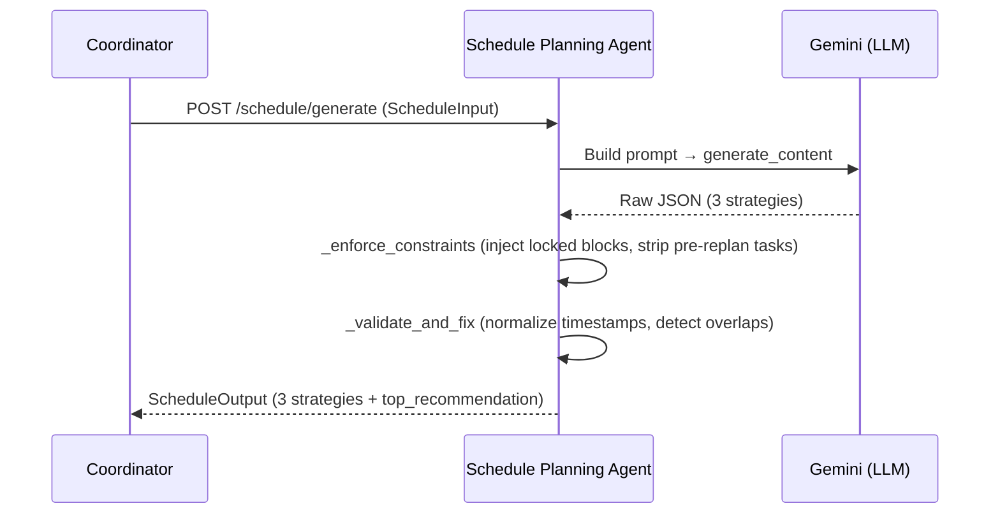

# Schedule Planning Agent — Integration Guide

## Table of Contents

- [1. How This Agent Works](#1-how-this-agent-works)
- [2. Running Locally](#2-running-locally)
- [3. API Reference](#3-api-reference)
  - [3.1 Health Check](#31-health-check)
  - [3.2 Generate Schedule](#32-generate-schedule)
- [4. Integration Guide by Caller](#4-integration-guide-by-caller)
  - [4.1 Coordinator Agent](#41-coordinator-agent)
  - [4.2 Goal Tracking Agent — Daily Output](#42-goal-tracking-agent--daily-output)
- [5. Codebase Structure](#5-codebase-structure)

---

## 1. How This Agent Works

The Schedule Planning Agent synthesizes all upstream agent outputs — health state, goal constraints, calendar events, locked blocks, and recurring habits — into a set of three optimized daily schedule strategies for the user.



The agent is stateless — it holds no sessions and writes nothing to a database. Every call is a fresh generation.

### Priority Order

When building the daily plan, the agent enforces a strict priority hierarchy:

1. **Locked blocks** — already-happened or immovable commitments; injected verbatim into every strategy.
2. **Recurring tasks** — daily habits the user has configured; must appear with their exact titles.
3. **Calendar events** — events pulled from Google Calendar; frozen before `replan_from_time` if set.
4. **Goal tasks** — sub-tasks and focus blocks from the Goal Tracking Agent; fill remaining free time.

### Replan Mode

When `replan_from_time` is set, the agent treats the current moment as a boundary. Everything before it is frozen; the agent only generates new tasks in the remaining hours of the day.

---

## 2. Running Locally

### Environment Variables

| Variable | Required | Description |
|---|---|---|
| `GEMINI_API_KEY` | Required | Gemini API key for LLM calls |
| `PLANNING_MODEL` | Optional | Gemini model ID; default `gemini-2.5-flash` |
| `API_BEARER_TOKEN` | Optional | Shared secret with Coordinator; leave empty to disable auth in dev |
| `PORT` | Optional | HTTP port; default `8002` |

### Install and Start

```bash
cd agents/Schedule_Planning_Agent
cp .env.example .env   # fill in GEMINI_API_KEY
pip install -e ".[dev]"
uvicorn app.main:app --reload --port 8002
```

> **Monorepo shortcut**: If the monorepo root already has a `.env` with `GEMINI_API_KEY`, no local `.env` is needed — the service reads the root file automatically.

### Verify

```bash
curl http://localhost:8002/health
# {"ok": true}
```

### Run Tests

```bash
pytest tests/unit/        # pure-function tests, no API key required
pytest tests/integration/ # full HTTP tests with mocked Gemini
pytest                    # all tests
```

---

## 3. API Reference

All endpoints accept and return `application/json`. Set `API_BEARER_TOKEN=""` in `.env` to disable auth in dev.

---

### 3.1 Health Check

#### `GET /health`

Returns `{"ok": true}` when the service is running. Used as a liveness probe.

```bash
curl http://localhost:8002/health
# {"ok": true}
```

#### `GET /healthz`

Alias for `/health`. Used by Cloud Run liveness probes.

---

### 3.2 Generate Schedule

#### `POST /schedule/generate`

**When to call:** After assembling all upstream context. The Coordinator calls this once per planning cycle (typically once per day, or on-demand when the user requests a replan).

**Request — `ScheduleInput`**

| Field | Type | Req | Description |
|---|---|---|---|
| `user_id` | string | Yes | Stable user identifier |
| `date` | string | Yes | Target date, `YYYY-MM-DD` |
| `calendar_events` | array | Yes | Events from Google Calendar; pass `[]` for cold start |
| `health` | object | No | `HealthOutput` from Health Agent |
| `goals` | object | No | `GoalsOutput` from Goal Tracking Agent |
| `user_preferences` | object | No | `preferred_work_hours`, `commute_minutes`, `break_frequency` |
| `locked_blocks` | array | No | `ScheduleTask` items that must appear unchanged in every strategy |
| `recurring_tasks` | array | No | Daily habits that must be scheduled today |
| `replan_from_time` | string | No | ISO 8601 datetime; if set, only plan the time window after this moment |

```json
{
  "user_id": "usr_4f2a1b8c",
  "date": "2026-05-28",
  "calendar_events": [
    {
      "id": "cal_abc123",
      "title": "CS 189 Lecture",
      "start_time": "2026-05-28T10:00:00-07:00",
      "end_time": "2026-05-28T11:30:00-07:00",
      "location": "Soda Hall 306"
    }
  ],
  "health": {
    "energy_level": "medium",
    "focus_window": "9PM-1AM",
    "cognitive_load_score": 0.72,
    "avoid_tasks": ["back-to-back deep work"]
  },
  "goals": {
    "goal_status": "behind_schedule",
    "progress_percent": 60.0,
    "urgency": "high",
    "suggested_blocks": ["Finish remaining 1h of linear algebra homework"],
    "daily_sub_tasks": [
      {
        "title": "Finish remaining 1h of linear algebra homework",
        "estimated_minutes": 60,
        "priority": "high"
      }
    ]
  },
  "user_preferences": {
    "preferred_work_hours": "late_night",
    "commute_minutes": 30,
    "break_frequency": 90
  },
  "locked_blocks": [],
  "recurring_tasks": [],
  "replan_from_time": null
}
```

**Response — `ScheduleOutput`**

| Field | Type | Description |
|---|---|---|
| `date` | string | Target date, echoed back |
| `strategies` | array | Exactly 3 `ScheduleStrategy` objects |
| `top_recommendation` | string | `"Most Productive"` \| `"Most Relaxed"` \| `"Fastest"` |
| `warnings` | array | Strings describing any detected issues (overlaps, meal timing, etc.) |
| `generated_at` | string | ISO 8601 UTC timestamp of generation |

**`ScheduleStrategy` schema**

| Field | Type | Description |
|---|---|---|
| `name` | string | `"Most Productive"` \| `"Most Relaxed"` \| `"Fastest"` |
| `description` | string | One-sentence summary of the strategy's philosophy |
| `tasks` | array | `ScheduleTask` list, sorted by `start_time` |
| `total_focus_hours` | float | Total deep-work hours in this strategy |
| `reasoning` | string | Explanation of trade-offs |

**`ScheduleTask` schema** (inside `tasks` and `locked_blocks`)

| Field | Type | Description |
|---|---|---|
| `task_id` | string | Unique identifier for this block |
| `title` | string | Display title |
| `start_time` | string | ISO 8601, e.g. `"2026-05-28T09:00:00"` |
| `end_time` | string | ISO 8601 |
| `type` | string | One of: `deep_work`, `routine`, `break`, `commute`, `exercise`, `study`, `meal`, `personal`, `preparation`, `sleep`, `calendar_event` |
| `location` | string\|null | Optional location |
| `notes` | string\|null | Optional notes |

```json
{
  "date": "2026-05-28",
  "strategies": [
    {
      "name": "Most Productive",
      "description": "Maximizes goal progress by front-loading deep work in the focus window.",
      "tasks": [
        {
          "task_id": "prod-wake",
          "title": "Wake up & Morning Routine",
          "start_time": "2026-05-28T08:00:00",
          "end_time": "2026-05-28T08:30:00",
          "type": "routine",
          "location": null,
          "notes": null
        },
        {
          "task_id": "prod-lecture",
          "title": "CS 189 Lecture",
          "start_time": "2026-05-28T10:00:00-07:00",
          "end_time": "2026-05-28T11:30:00-07:00",
          "type": "calendar_event",
          "location": "Soda Hall 306",
          "notes": null
        }
      ],
      "total_focus_hours": 3.5,
      "reasoning": "Heavy deep work blocks placed in the late-night focus window to respect cognitive load."
    }
  ],
  "top_recommendation": "Most Productive",
  "warnings": [],
  "generated_at": "2026-05-28T17:00:00Z"
}
```

**Integration rules**

- The three strategy names are always exactly `"Most Productive"`, `"Most Relaxed"`, and `"Fastest"`.
- `locked_blocks` are injected into every strategy verbatim — do not expect their positions to change.
- Tasks in `calendar_events` that overlap with `locked_blocks` are automatically excluded from the final output (locked blocks win).
- When `replan_from_time` is set, tasks before that timestamp in the output are either locked blocks or real calendar events — never newly invented tasks.
- `warnings` is informational only; a non-empty `warnings` array does not indicate failure.
- The endpoint is idempotent within the same context — same inputs produce structurally equivalent outputs (minor LLM variation in descriptions/reasoning is expected).

---

## 4. Integration Guide by Caller

### 4.1 Coordinator Agent

The Coordinator is the primary caller. Typical flow:

1. Fetch calendar events via `_local/calendar_client.py` or the Calendar API.
2. Collect `HealthOutput` from the Health Agent.
3. Collect `GoalsOutput` from the Goal Tracking Agent (`POST /v1/scheduled/daily-output`).
4. POST all context to `POST /schedule/generate`.
5. Present `top_recommendation` strategy to the user; store the full `ScheduleOutput` for later replanning.

**Replan flow** (user is interrupted mid-day):

1. Move already-completed or in-progress blocks to `locked_blocks`.
2. Set `replan_from_time` to the current timestamp.
3. POST to `/schedule/generate` again — the agent will only fill time after `replan_from_time`.

---

### 4.2 Goal Tracking Agent — Daily Output

When the Goal Tracking Agent calls `POST /v1/scheduled/daily-output`, it returns a `GoalsOutput` per active goal. Pass this directly as the `goals` field of `ScheduleInput`.

The `daily_sub_tasks` array inside `GoalsOutput` drives the goal section of the prompt. If `daily_sub_tasks` is empty but `suggested_blocks` is populated, the agent falls back to the suggested blocks list. If both are empty, the goals section is omitted from the prompt.

---

## 5. Codebase Structure

```text
agents/Schedule_Planning_Agent/
├── app/
│   ├── agent/
│   │   └── schedule_agent.py   Core logic: prompt builder, constraint enforcer,
│   │                            validator, ScheduleAgent class
│   ├── api/
│   │   ├── deps.py             Optional Bearer auth dependency
│   │   ├── health_routes.py    GET /health, GET /healthz
│   │   └── schedule_routes.py  POST /schedule/generate
│   ├── config.py               pydantic-settings (GEMINI_API_KEY, PLANNING_MODEL, etc.)
│   └── main.py                 FastAPI app factory
├── tests/
│   ├── unit/
│   │   └── test_helpers.py     Pure-function tests (_naive_dt, _times_overlap, etc.)
│   └── integration/
│       └── test_schedule_endpoint.py  Full HTTP tests with mocked Gemini
├── docs/
│   └── user_manual.md          This file
├── Dockerfile
├── cloudbuild.yaml
├── pyproject.toml
└── .env.example
```

**Shared schemas** live at `schemas/schedule.py` in the monorepo root and are never copied into this service. The `app/agent/schedule_agent.py` module adds the monorepo root to `sys.path` at import time for local development; in Docker, `COPY schemas/ ./schemas/` makes them available at `/app/schemas/`.


