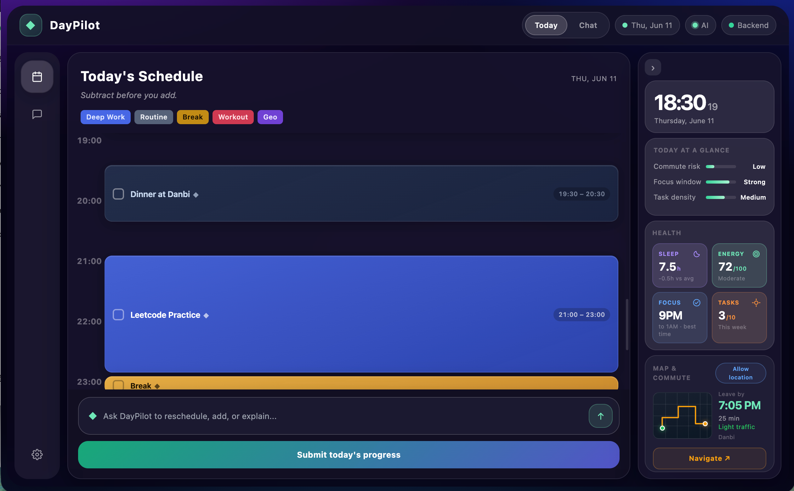

# DayPilot

> "Your calendar knows your meetings. DayPilot knows your life."

**Demo Video:** https://youtu.be/NF6q8QUmsBw?si=tSWPXdPFkXY8iYmR



---

## Quick Start

```bash
# 1. Copy .env and fill in keys
cp .env.example .env
# Required: GEMINI_API_KEY, MONGODB_URI, GOOGLE_CLIENT_ID, GOOGLE_CLIENT_SECRET

# 2. Install dependencies
pip install -r requirements.txt

# 3. Seed demo data
python scripts/seed_demo.py

# 4. Start the server
python main.py
# → http://localhost:8000/docs
```

---

## What is DayPilot?

Every scheduling tool — Motion, Reclaim, Akiflow — assumes you already know what matters today. They arrange what you tell them. They are reactive by design.

DayPilot flips this. It surfaces what you haven't thought of yet and weaves it proactively into your day.

- Notices your 3-month anniversary is next week
- Detects your favorite artist's tickets drop in 3 days
- Knows you have 4 Leetcode problems left and your focus window is 9PM–1AM
- Back-calculates when you need to leave given your commute

> "Every scheduler assumes you know what matters today. DayPilot doesn't."

---

## Architecture

Single FastAPI server with a Google ADK coordinator agent. Context is pre-loaded in parallel before each turn via ADK's `before_agent_callback`, so Gemini always has fresh user data without needing to decide which tools to call.

```
User
  ↓
POST /chat/
  ↓
before_agent_callback (parallel, every turn)
  ├── read_user_context          ─┐
  ├── track_goals                 │  asyncio.gather → inject into session state
  ├── get_relationship_context    │
  └── analyze_health             ─┘  (full PsychoBio pipeline — PSI, PLI, energy, focus window)
  ↓
Coordinator Agent (Google ADK + Gemini 2.5 Flash)
  ├── Reads pre-loaded context from session state
  ├── Proactively surfaces goals, upcoming dates, schedule
  └── Calls additional tools on demand:
      ├── plan_schedule           → 3 optimized daily strategies
      ├── adjust_schedule         → real-time replanning
      ├── get_geo_info            → commute segments via Google Routes API
      ├── write_entity_to_memory  → persist facts from conversation
      ├── store_conversation_memory → vector embedding → MongoDB
      ├── clear_pending_reschedule → after task rescheduling confirmed
      └── MongoDB MCP             → direct Knowledge Graph queries

POST /schedule/feedback (end-of-day checkbox)
  ├── Stores pending_reschedule in user_preferences (progress is cumulative — skipping a task never decrements it)
  └── Next /chat/ turn: coordinator detects pending tasks and reschedules
```

---

## Memory System

**Knowledge Graph (MongoDB Atlas)**
- `entities` — people, interests, events with relations and upcoming dates
- `user_preferences` — focus window, energy pattern, commute, pending reschedules
- `goal_state` — weekly goals with progress tracking
- `conversation_memory` — vector embeddings (Atlas Vector Search, 3072-dim)

**How memory grows**
- Cold start: Google OAuth → reads Calendar, Gmail, Contacts → Gemini extracts entities → MongoDB
- Per turn: `before_agent_callback` preloads context in parallel (no per-request tool call latency); relationship context and health analysis are cached (30 min / 10 min TTL) — first call is cold, subsequent calls are instant
- After each turn: background consolidation → Gemini compresses insight → `store_conversation_memory`
- Next session: `retrieve_relevant_memories` semantically retrieves relevant past context
- End of day: `/schedule/feedback` stores uncompleted tasks → coordinator reschedules on next turn

---

## Agent Tools

| Tool | Description | Status |
|---|---|---|
| `read_user_context` | Loads preferences, goals, upcoming events from MongoDB | Ready |
| `track_goals` | Reads goal state, uses Gemini to assess urgency and suggest blocks | Ready |
| `get_relationship_context` | Surfaces upcoming important dates with Gemini suggestions | Ready |
| `retrieve_relevant_memories` | Semantic search over past conversation memories | Ready |
| `plan_schedule` | Generates 3 daily schedule strategies with constraint enforcement | Ready |
| `adjust_schedule` | Real-time replanning when disruptions occur | Ready |
| `get_geo_info` | Multi-segment commute calculation via Google Routes API | Ready |
| `write_entity_to_memory` | Persists entities extracted from conversation | Ready |
| `store_conversation_memory` | Embeds and stores conversation insights | Ready |
| `clear_pending_reschedule` | Clears pending task reschedule after confirmation | Ready |
| `analyze_health` | PsychoBio pipeline — energy_level, focus_window, cognitive_load_score, avoid_tasks | Ready |
| `MongoDB MCP` | Direct Knowledge Graph queries via MCP protocol | Ready |

---

## Tech Stack

| Layer | Technology |
|---|---|
| LLM | Gemini 2.5 Flash (coordinator) · Gemini 2.5 Flash-Lite (preload tools) |
| Agent framework | Google ADK (`before_agent_callback`, `MCPToolset`) |
| Backend | Python + FastAPI |
| Database | MongoDB Atlas (Knowledge Graph + Vector Search) |
| MCP | mongodb-mcp-server (stdio subprocess) |
| Embeddings | gemini-embedding-001 (3072 dim) |
| Vector Search | MongoDB Atlas Vector Search |
| Auth | Google OAuth 2.0 (Calendar + Gmail + Contacts) |
| Geo | Google Routes API (transit → walking → driving fallback) |

---

## Demo Scenario

Kai opens DayPilot on Wednesday morning. He says nothing.

DayPilot already knows:
- Mia = partner → 3-month anniversary in 8 days
- Favorite artist → tickets drop in 3 days
- Leetcode goal: 6/10 done, 4 remaining, deadline Friday
- Today: ML class 2PM–4PM at library (30 min from home)
- Focus window: 9PM–1AM

DayPilot proactively surfaces:
```
"Your 3-month anniversary with Mia is in 8 days. Want me to block
Saturday evening and look up restaurants near campus?"

"Your favorite artist's tickets drop in 3 days. Want a reminder
the moment they go live?"

"You have 4 Leetcode problems left this week. I've blocked 9PM–11PM
tonight. Leave for the library by 9:15AM — that gives you a 90-minute
window this morning for 2 problems first."
```

That evening, Kai didn't finish his Leetcode session. He checks the box in the UI. DayPilot asks if he wants to reschedule — he says yes, and it automatically slots it into tomorrow.

---

## API Reference

See [docs/api.md](docs/api.md) for full endpoint documentation.

Key endpoints:
- `POST /chat/` — main conversation interface
- `POST /schedule/feedback` — end-of-day task completion feedback
- `POST /schedule/adjust` — real-time schedule adjustment
- `GET /auth/google` — Google OAuth login

---

## Judging Criteria

| Criterion | Our answer |
|---|---|
| Technical implementation | ADK `before_agent_callback`, Knowledge Graph, Vector Search, MCP, Google Routes API |
| Originality | Proactive life-awareness + closed feedback loop; no existing scheduler knows your life |
| Potential impact | Works for any user across any life domain |
| Design & UX | Zero onboarding; proactive suggestions surface naturally in chat; end-of-day feedback loop |

---

## Observability — Dynatrace + OpenTelemetry

Every agent call, LLM invocation, health pipeline node, and HTTP request is instrumented with OpenTelemetry and exported to Dynatrace. The coordinator agent can also query Dynatrace about its own performance via MCP.

**What's instrumented:** HTTP middleware, all 10 agent tools (`@traced_tool`), Gemini LLM calls (`@traced_llm`), the full 4-node health pipeline, coordinator context preload, chat endpoint, and background memory consolidation.

**Self-monitoring:** Set `DT_MODE=on_demand` and the coordinator can answer "how's your latency?" by querying its own traces in Dynatrace.

**Claude Code integration:** The `.mcp.json` connects the Dynatrace MCP server — ask natural language questions about telemetry directly from your terminal.

See **[docs/DYNATRACE.md](docs/DYNATRACE.md)** for the full guide — setup, every instrumented component, DQL query examples, and testing instructions.

---

*DayPilot — Google Cloud Rapid Agent Hackathon 2026*